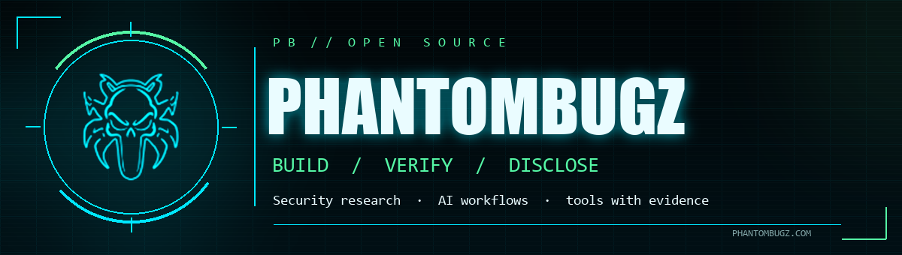
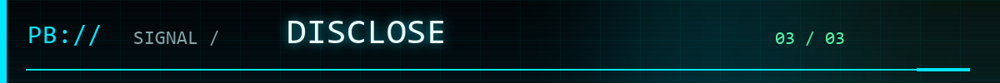

# PhantomBugz

We build practical tools for AI workflows and incident response. Our security research is authorized and disclosed responsibly.

<picture>
  <source media="(prefers-reduced-motion: no-preference)" srcset="assets/profile-signal.gif">
  
</picture>

## Open work

### [liveD LoRA Studio](https://github.com/PhantomBugz/lived-lora-studio)

**Apache-2.0 developer preview · [source prerelease](https://github.com/PhantomBugz/lived-lora-studio/releases/tag/v0.1.0.dev0)**

Run a synthetic encrypted-review demo with approved-only export. A separate picker selects an exact local or remote NVIDIA GPU target. **Training is pending.** [Run the demo](https://github.com/PhantomBugz/lived-lora-studio#try-the-review-and-export-demo) · [Release status](https://github.com/PhantomBugz/lived-lora-studio/blob/main/docs/STATUS.md).

### [Zombie Killer](https://github.com/PhantomBugz/Zombie-Killer-AI)

**Apache-2.0 source alpha · [v0.1.0-alpha.1 prerelease](https://github.com/PhantomBugz/Zombie-Killer-AI/releases/tag/v0.1.0-alpha.1)**

A local-first containment console for AI-agent processes and supported memory stores. Windows and Ubuntu Linux are the alpha source qualification targets; macOS native workflows remain unqualified. The browser preview is synthetic, and no signed installer is claimed. [Project page](https://phantombugz.com/zombie-killer.html) · [Quick start](https://github.com/PhantomBugz/Zombie-Killer-AI#quick-start).

## Public work

### [Aftershock](https://github.com/PhantomBugz/aftershock)

A DataHub-backed incident response agent with governed remediation and auditable receipts. [Watch the demo](https://youtu.be/yopSGs_kx5s).

Find project updates at [phantombugz.com](https://phantombugz.com/). [Venice CLI Downloads](https://github.com/PhantomBugz/Venice-CLI-Downloads) hosts public release artifacts and installation instructions; its source repository is private.

Reproducible feedback and contributions are welcome in each public project's repository.
